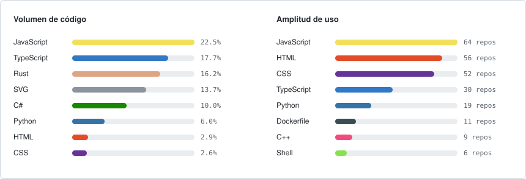

  

  
  

<h1 align="center">Harold G. S.</h1>

  <strong>Software Developer</strong> &nbsp;·&nbsp; Full Stack &nbsp;·&nbsp; IA &nbsp;·&nbsp; Cloud &nbsp;·&nbsp; Mobile

  Construyo productos web, móviles y arquitecturas cloud, e integro IA generativa en sistemas reales.

  
  
  

---

## Stack

  

---

## Experiencia

**MIGOZZ** — Desarrollador Full Stack &nbsp;·&nbsp; sep. 2026 – Actualidad 
Plataforma social para creadores, marcas y artistas en Android, iOS y Web. Flutter, Firebase, Cloud Functions, Stripe.

  
  
  

**Mitsubishi Electric de Colombia** — Desarrollador de Software, SAP / SAP Fiori &nbsp;·&nbsp; ene. 2026 – jul. 2026 
Migración full stack de servicios SAP para cinco áreas de la empresa, servicios OData y apps SAP Fiori / SAPUI5.

---

## Proyectos Destacados

| Proyecto | Qué es | Stack |
| :--- | :--- | :--- |
| ARIA | Asistente con IA generativa para soporte SAP | AWS, Bedrock, Python, React |
| [Hecho en Sabaneta](https://hechoensabaneta.com) | Plataforma de comercio local con catálogo y carrito | TypeScript, Next.js, Firebase |
| [Arcoiris Zapatería](https://arcoiriszapateria.com) | Sitio de servicios para un taller de restauración | TypeScript, Next.js, Firebase |
| [SENA Cloud](https://senacloud.netlify.app/) | Plataforma de gestión académica y administrativa | TypeScript, React, MongoDB |
| CashWin | Videojuego multijugador de dados con pagos | Unity, C#, Photon PUN 2 |
| SensoresAPP | Sistema de alerta temprana ante inundaciones | Arduino, C++, IoT |

---

<!-- PRIVATE-REPOS:START -->
<!-- PRIVATE-REPOS:END -->

## Actividad en GitHub

  

  

---

  
  

