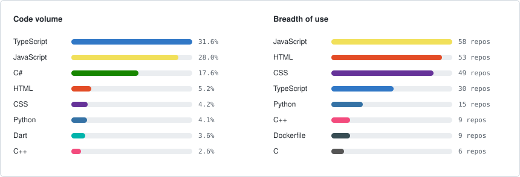

  
  

  

  
  
  

---

## Technologies

**Frontend**

  

**JavaScript and TypeScript**

  

**Backend and Databases**

  

**Artificial Intelligence and Computer Vision**

  

**Cloud, DevOps and Tools**

  

**Mobile**

  

**Game Development and IoT**

  

**Development Environment**

  

---

## Experience

**MIGOZZ** — Full Stack Developer &nbsp;·&nbsp; Sep 2026 – Present 
Social platform for creators, brands and artists on Android, iOS and Web. Flutter, Firebase, Cloud Functions, Stripe.

  
  
  

**Mitsubishi Electric de Colombia** — IT Apprentice, SAP / SAP Fiori Development &nbsp;·&nbsp; Jan 2026 – Jul 2026 
OData services and SAP Fiori / SAPUI5 apps, plus incident analysis and functional testing.

---

## Featured Projects

| Project | What it is | Stack |
| :--- | :--- | :--- |
| ARIA | Generative AI assistant for SAP support | AWS, Bedrock, Python, React |
| [Hecho en Sabaneta](https://hechoensabaneta.com) | Local commerce platform with catalog and cart | TypeScript, Next.js, Firebase |
| [Arcoiris Zapatería](https://arcoiriszapateria.com) | Service site for a leather restoration workshop | TypeScript, Next.js, Firebase |
| [SENA Cloud](https://senacloud.netlify.app/) | Academic and administrative management platform | TypeScript, React, MongoDB |
| CashWin | Real-time multiplayer dice game with payments | Unity, C#, Photon PUN 2 |
| SensoresAPP | Early warning system for floods | Arduino, C++, IoT |

---

<!-- PRIVATE-REPOS:START -->
<!-- PRIVATE-REPOS:END -->

## GitHub Activity

  

  

---

  
  

